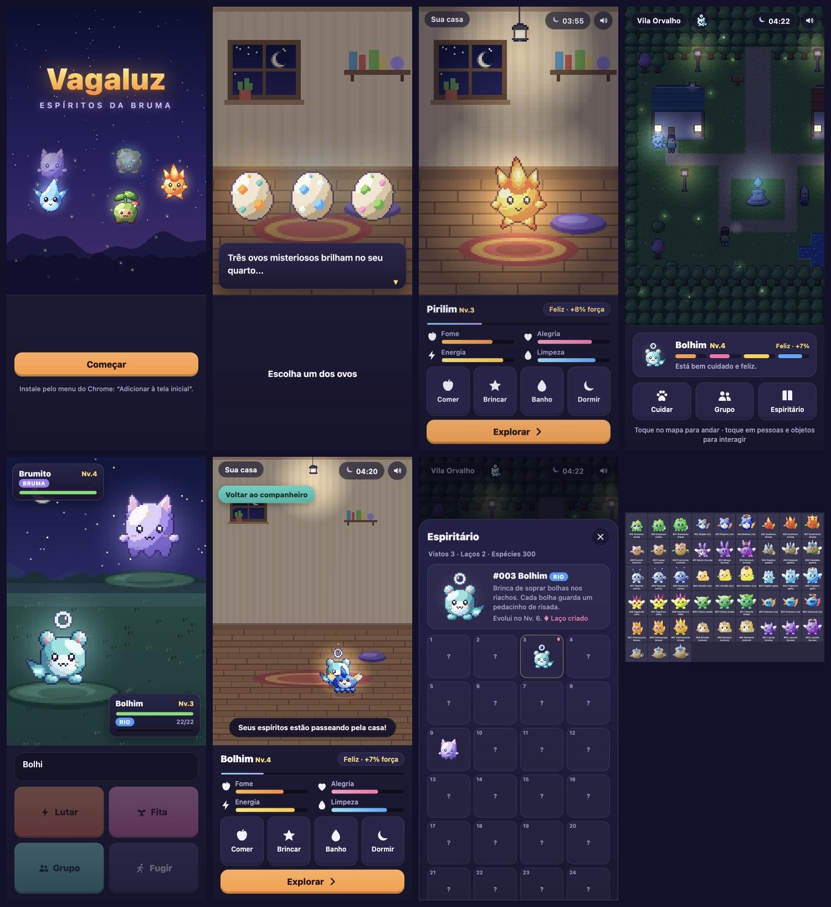

# Vagaluz — Espíritos da Bruma

Um jogo original de **bichinho virtual + aventura de capturar criaturas**, feito para rodar no navegador do celular (testado no tamanho de um Moto G10). Funciona offline depois de instalado e salva o progresso no próprio aparelho.



## O que já dá pra fazer

- **Escolher um entre 3 ovos** (chama, água e folha), tocar para chocar e dar um nome ao companheiro.
- **Cuidar dele**: Fome, Alegria, Energia e Limpeza caem com o tempo real, mesmo com o jogo fechado. Dá para dar comida, brincar, dar banho (esfregando com o dedo) e colocar para dormir. Um espírito bem cuidado fica **mais forte nas batalhas**.
- **Explorar tocando no mapa**: o personagem anda sozinho até onde você tocou. Tocar em pessoas e objetos faz ele ir até lá e interagir. O companheiro sempre te segue.
- **Dia e noite de verdade**, seguindo o relógio do celular: lampiões, janelas acesas e vaga-lumes à noite. Alguns espíritos só aparecem no escuro.
- **Batalhas por turnos** com 10 tipos (Comum, Brasa, Rio, Mata, Bruma, Pedra, Vento, Luz, Gelo e Raio) e mais de 40 golpes.
- **Criar laços** com espíritos selvagens usando Fitas-encanto, num grupo de até 6. Os demais vão morar na sua casa.
- **300 espécies** com evoluções de até 3 estágios. As 18 principais foram desenhadas à mão (em código) e as outras 282 vêm de um gerador que monta cada criatura de forma única e sempre igual.
- **Espiritário**: a coleção com todas as espécies que você já viu e com quem criou laço.
- **Domadores**: Lia (sul da trilha) e Duda (norte) desafiam você para batalhas com vários espíritos.
- **Habitat**: dentro de casa, o botão “Habitat” mostra todos os seus espíritos passeando juntos. É o primeiro passo para o habitat estilo Habbo.
- **Trocar de companheiro**: no Grupo, qualquer espírito pode virar o seu companheiro.

Toda a arte, os nomes, os mapas e as músicas são originais e gerados por código. Nenhum personagem de outro jogo foi usado.

## Como jogar no celular

### Jeito 1: teste rápido no mesmo Wi-Fi (sem instalar nada)

1. No Mac, abra o **Terminal** e rode:
   ```bash
   cd ~/Downloads/pocket-pet-main/monster-pet-game && python3 -m http.server 8137
   ```
2. Descubra o endereço do Mac na rede:
   ```bash
   ipconfig getifaddr en0
   ```
   (aparece algo como `192.168.0.9`)
3. No celular, conectado ao **mesmo Wi-Fi**, abra o Chrome e digite `http://192.168.0.9:8137` (troque pelo número que apareceu).

Assim o jogo roda e salva normalmente. Mas, como não é um endereço seguro (https), o Chrome não ativa o modo offline: o atalho da tela inicial só funciona com o Mac ligado e o comando rodando.

### Jeito 2 (recomendado): site grátis com https, instalável e offline

Publicando a pasta num site gratuito com https (por exemplo o **GitHub Pages**), o jogo vira um app de verdade:

1. Abra o link do jogo no Chrome do celular.
2. Toque no menu **⋮** e depois em **“Instalar app”** ou **“Adicionar à tela inicial”**.
3. Pronto: o ícone do Vagaluz aparece na tela inicial, abre em tela cheia e **funciona sem internet**.

> O save fica guardado no navegador do celular. Desinstalar o app ou limpar os dados do Chrome apaga o progresso.

## Dicas

- Fale com a **Vó Cida** no Santuário (centro da vila) para ganhar mais Fitas-encanto.
- Toque no **cristal do Santuário** para curar o grupo e repor as fitas.
- Para ver a vila à noite em qualquer horário, abra o jogo com `?hora=21` no fim do endereço (por exemplo `http://192.168.0.9:8137/?hora=21`).
- Para recomeçar do zero: tela inicial → **Novo jogo**.

## Para quem for mexer no código

- Não precisa instalar nada nem compilar: é HTML, CSS e JavaScript puro (módulos ES).
- `js/sprites.js`: toda a pixel art (criaturas, personagens, tiles, casas).
- `js/gen.js`: gerador determinístico das 282 espécies extras (nome, cores, partes do corpo, golpes e evolução).
- `js/data.js`: tipos, golpes, espécies, encontros e domadores.
- `js/world.js` (exploração), `js/battle.js` (batalhas), `js/pet.js` (bichinho, habitat e ovos), `js/scenes.js` (título e evolução).
- `tools/sheet.html`: galeria de todas as espécies (abra pelo servidor local em `/tools/sheet.html`).
- `tools/make-icons.mjs`: gera os ícones do app (`node tools/make-icons.mjs`).
- Ao mudar arquivos, aumente `VERSION` em `sw.js` para os celulares baixarem a versão nova.

## Próximos passos (ideia do habitat)

O objetivo final é virar um **habitat estilo Habbo** com essas criaturas: quartos onde elas vivem e passeiam, móveis para decorar e, quem sabe, visitas de amigos online. Visitas online precisam de um servidor, então fica para uma etapa separada.
